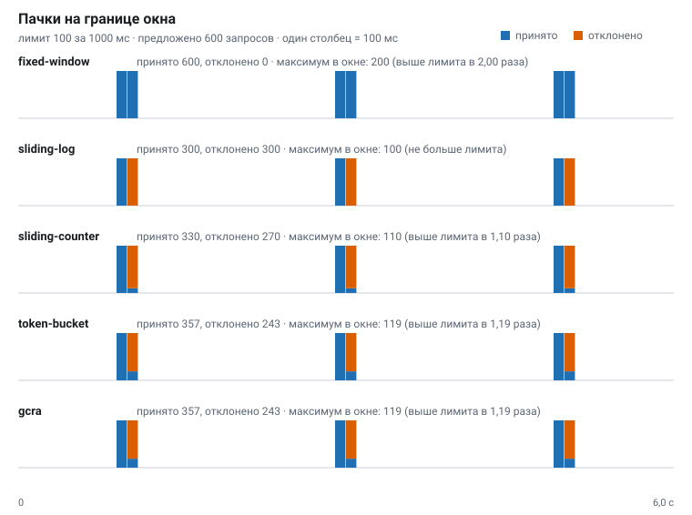

# rate-limiter-lab

[](https://github.com/Oleg4311/rate-limiter-lab/actions/workflows/ci.yml)

Пять алгоритмов ограничения частоты запросов (fixed window, sliding log, sliding counter, token bucket, GCRA) за одним интерфейсом на Go. К ним лаборатория, которая прогоняет все алгоритмы на одном и том же трафике и показывает, **где какой из них пропускает лишнее**, HTTP-middleware с заголовками `RateLimit-*` и демонстрационный сервис, который можно нагрузить k6.

**Демо в браузере (Go → WebAssembly):** https://oleg4311.github.io/rate-limiter-lab/ · [English](#english)



## Быстрый старт

Скачайте `ratelab` для своей системы на странице [Releases](https://github.com/Oleg4311/rate-limiter-lab/releases) (сверьте SHA-256 из `SHA256SUMS`) или `go install github.com/Oleg4311/rate-limiter-lab/cmd/ratelab@latest`.

```
ratelab compare --pattern boundary --limit 100 --window 1s --svg boundary.svg
ratelab serve --addr 127.0.0.1:8080 --limit 100 --window 1s
curl -i http://127.0.0.1:8080/limited/gcra
```

Результат `compare` для пачек на границе окна (лимит 100 за секунду, 600 запросов):

```
алгоритм          принято  отклонено   макс. в окне  относительно лимита
fixed-window          600          0            200  выше лимита в 2,00 раза
sliding-log           300        300            100  не больше лимита
sliding-counter       330        270            110  выше лимита в 1,10 раза
token-bucket          357        243            119  выше лимита в 1,19 раза
gcra                  357        243            119  выше лимита в 1,19 раза
```

Настоящий ответ сервиса при отказе (запущен с `--limit 5 --window 1s`, после пачки из 8 запросов):

```
HTTP/1.1 429 Too Many Requests
Retry-After: 1
RateLimit-Limit: 5
RateLimit-Remaining: 0
RateLimit-Reset: 1
Content-Type: application/json; charset=utf-8

{"error":"too_many_requests","message":"Слишком много запросов","retry_after_ms":195}
```

`Retry-After` и `RateLimit-Reset` в заголовках округляются вверх до целых секунд (минимум 1), точное время лежит в `retry_after_ms`.

## Как использовать как библиотеку

```go
l, _ := limiter.New(limiter.GCRA, limiter.Config{Limit: 100, Window: time.Second, Burst: 20})

d := l.Allow("client-42", time.Now())
if !d.Allowed {
    // d.RetryAfter: через сколько повторить, d.Remaining, d.ResetAfter для заголовков
}

// или как middleware: ограничение по IP или заголовку X-API-Key
handler := httpmw.Middleware(l, httpmw.Options{})(next)
```

Время передаётся в каждый вызов, поэтому алгоритмы детерминированы и тестируются без `sleep`. Для одного ключа время не должно убывать; если часы «пошли назад», момент округляется до последнего увиденного.

## Чем отличается

- **Не описание, а эксперимент.** Статьи рассказывают про «проблему границы окна», здесь её можно запустить и увидеть на графике, меняя лимит, окно и форму трафика.
- **Сравнение честное.** Все алгоритмы получают один и тот же детерминированный поток, поэтому разница в результате — это разница алгоритмов, а не случайности.
- **Правильность проверена свойствами, а не примерами:** сверка скользящего журнала с эталонной моделью; token bucket и GCRA дают одинаковые решения на случайных потоках; `RetryAfter` точен до наносекунды (запрос чуть раньше отклоняется, ровно в срок проходит); конкурентные клиенты с одним ключом никогда не получают больше лимита.
- **Находки, а не рекламный текст.** См. раздел ниже.

## Алгоритмы

| Алгоритм | Память на ключ | Что гарантирует | Цена |
|---|---|---|---|
| `fixed-window` | O(1) | не больше лимита в каждом выровненном окне | до **2×лимит** за любую секунду на стыке окон |
| `sliding-log` | O(лимит) | **не больше лимита в любом окне**, точно | память растёт вместе с лимитом |
| `sliding-counter` | O(1) | дёшево, ошибка мала при ровном трафике | до **~2×лимит** при пачках в конце окна |
| `token-bucket` | O(1) | пачка до `burst`, затем средняя скорость | за окно пройдёт до `burst + лимит` |
| `gcra` | O(1), одно целое | то же поведение, что `token-bucket`, без float | то же |

## Что нашли по ходу работы

1. **Скользящий счётчик не даёт гарантий, которые ему часто приписывают.** Он считает прошлое окно «равномерным» и обманывается пачками в его конце: при пачке в 990 мс и второй пачке через 0,91 с пропускает около 190 из 200 за 0,91 секунды (тест `TestSlidingCounterWorstCase`). При ровном трафике он очень хорош, при всплесках нет.
2. **Путь отказа тоже стоит денег.** Первая версия считала `RetryAfter` скользящего счётчика двоичным поиском: бенчмарк показал 481 нс на запрос против ~50 у остальных. Для лимитера это уязвимость: тот, кто чаще всех получает отказы, нагружал сервер сильнее всех. Теперь формула плюс несколько шагов уточнения: 136 нс, точность до наносекунды сохранена тестом. Бенчмарк `BenchmarkDenied` позволяет следить, чтобы путь отказа не отставал.
3. **Token bucket и GCRA математически одно и то же**, и тест это подтверждает на случайных потоках. Выбор между ними — вопрос представления (float против целого числа), а не поведения.

## Скорость

Go 1.27, Intel i7-10750H, 12 потоков, Windows. Один запрос (`go test -bench`); это замер на одном ноутбуке, а не обещание производительности.

| Алгоритм | пропуск, много ключей параллельно | отказ, один ключ |
|---|---|---|
| fixed-window | 32 нс | 51 нс |
| sliding-log | 39 нс | 46 нс |
| sliding-counter | 35 нс | 136 нс |
| token-bucket | 35 нс | 53 нс |
| gcra | 32 нс | 47 нс |

Состояние хранится в 64 шардах с отдельными мьютексами. В бенчмарках 0 аллокаций на запрос (у sliding-log в среднем 17 байт на запрос из-за роста журнала).

## Нагрузка k6 на настоящий сервис

Результат прогона в CI ([k6/compare.js](k6/compare.js)): `ratelab serve` с лимитом 100 запросов/с, на каждый алгоритм поток 200 запросов/с в течение 5 секунд (1000 запросов), раннер GitHub Actions, localhost.

| Алгоритм | принято | отклонено |
|---|---|---|
| fixed-window | 597 | 404 |
| sliding-log | 500 | 501 |
| sliding-counter | 549 | 451 |
| token-bucket | 599 | 402 |
| gcra | 599 | 402 |

Числа совпадают с теорией: sliding-log пропускает ровно 100 в секунду (500 за 5 с), token-bucket и GCRA дают пачку 100 плюс 100/с (≈600), fixed-window «подтекает» на границах окон. Задержка p99 ≈ 0,2 мс. Это замер на общем облачном раннере: он показывает соотношение алгоритмов, а не пропускную способность сервиса.

## Как проверяется

- **Свойства и эталон** (пакет `limiter`): см. «Чем отличается». Тесты проверены мутациями: сдвиг допуска GCRA или границы окна в журнале ломает соответствующие тесты.
- **Конкурентность:** 64 горутины × 200 вызовов с одним ключом и 300 независимых ключей; в CI на Linux идут под `go test -race`.
- **Настоящий HTTP и настоящие часы:** корзина токенов и параллельные клиенты через `httptest`, границы допустимого считаются по измеренному времени.
- **Документация не может устареть:** график в README сверяется с кодом тестом (`go test ./lab -update` обновляет).
- **k6:** в CI поднимается `ratelab serve`, и для каждого алгоритма идёт поток 200 запросов/с при лимите 100/с. Тест проверяет, что принято примерно «лимит × время», а все 429 содержат `Retry-After`. Скрипт: [k6/compare.js](k6/compare.js).
- Демо проверяется смоук-тестом: WASM загружается в Node и воспроизводит ожидаемые числа.

## Ограничения

Состояние хранится в памяти одного процесса: для нескольких инстансов нужно общее хранилище (например, Redis со скриптом). Алгоритмы устроены так, что их состояние — одна небольшая структура на ключ, поэтому перенос возможен. Лимитер не отличает «злонамеренный» трафик: ключ клиента выбираете вы (по умолчанию IP или `X-API-Key`; `X-Forwarded-For` не читается, чтобы его нельзя было подделать).

## Разработка

```
go test ./...                              # все тесты
go test -run xxx -bench . ./limiter        # бенчмарки
go test ./lab -update                      # перегенерировать графики в docs/
node scripts/build-site.mjs && node scripts/wasm-smoke.mjs site   # демо (нужны Go и Node)
```

## English

**rate-limiter-lab** compares five rate-limiting algorithms (fixed window, sliding log, sliding counter, token bucket, GCRA) on identical deterministic traffic, so differences such as the fixed-window boundary burst (up to 2× the limit) can be seen rather than read about. It ships a Go library with an injectable clock, HTTP middleware with `RateLimit-*`/`Retry-After` headers, a demo service load-tested with k6 in CI, and a browser demo (Go → WebAssembly). Findings: the sliding counter can also allow ~2× under bursts at the end of a window, and the denied path must be as cheap as the allowed one (a binary-search `RetryAfter` made it 10× slower; fixed).

---

Лицензия MIT · Сделано с помощью Claude
